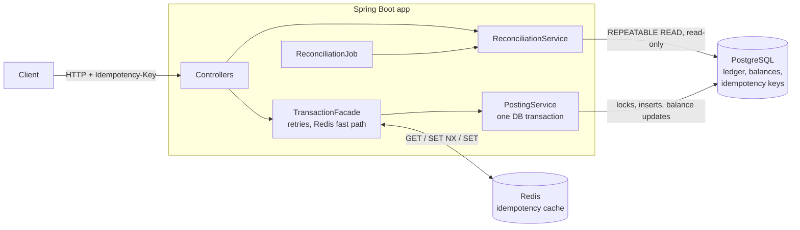

# Ledger Engine

A double-entry financial ledger built with Java 21, Spring Boot 3.5, PostgreSQL 17 and Redis 7.

Every money movement is one database transaction that writes a balanced pair of ledger entries: a debit on one account and a credit on the other. This covers deposits, withdrawals, transfers and reversals.
- **Amounts:** stored as whole paise in `BIGINT` columns, so no floating-point arithmetic is involved.
- **Locking:** accounts are locked in a fixed order (ascending id), so concurrent transfers can't deadlock.
- **Retries:** every money-moving request needs an `Idempotency-Key` header, so a retried request is applied once and replays the original response.
- **Integrity in the database:** Postgres triggers make the ledger tables append-only and reject an unbalanced transaction at commit.
- **Reconciliation:** recomputes every balance from the ledger and proves that all balances sum to zero.

## Status

Built so far:
- the posting engine with pessimistic locking and database-backed idempotency;
- the Redis idempotency cache with a Postgres fallback;
- reversals, account statements, and freezing or closing accounts;
- reconciliation (on demand and scheduled) with metrics and correlation ids in the logs;
- JMeter load tests with published results;
- design notes.

`./mvnw verify` runs 300+ tests.

## Features

- Accounts: create, read, freeze, unfreeze, close (only at zero balance). Account numbers come from a Postgres sequence (`ACC1000000001`, ...).
- Deposits, withdrawals and transfers. Each needs an `Idempotency-Key`, and repeats replay the original response with `Idempotent-Replayed: true`.
- Reversals: a new transaction that moves the money back, at most once per transaction. A reversal can't itself be reversed.
- Account statements with keyset pagination, newest first.
- Reconciliation: `GET /api/v1/admin/reconciliation`, plus a scheduled run every 5 minutes that logs ERROR and increments a metric on any failure.
- Errors as `application/problem+json`, each with a stable `code`. Neither stack traces nor SQL reach the client.
- Metrics (`ledger.postings{type,result}`, `ledger.idempotency.replays{source}`, `ledger.lock.retries`), and logs tagged with the correlation id, idempotency key and transaction id.
- OpenAPI docs at `/swagger-ui.html`.

## Architecture



**Request path:**
1. A controller validates the request and converts the amount to paise.
2. It hands a command to `TransactionFacade`, which is deliberately not transactional.
3. The facade checks Redis for the idempotency key, marks the key in progress, and calls `PostingService`.
4. `PostingService` does all the database work in one transaction.

**Retries:** when Postgres reports a deadlock or a lock timeout, the facade retries the whole transaction up to three times. A retry has to start a new transaction, because Postgres rejects every statement in an aborted one.

**Redis's role:** Redis is only a cache in front of the `idempotency_keys` table. If it is down, every request takes the Postgres path and stays exactly-once.

**Reconciliation** reads the whole ledger in one read-only snapshot, so it never blocks writers.

The transfer sequence diagram, the data model and the failure-scenario table are in [docs/design.md](docs/design.md).

## Key design decisions

- **Paise as BIGINT.**
  - Amounts arrive as JSON strings with at most two decimals, such as `"1000.50"`, and are parsed straight into a `long` number of paise.
  - Arithmetic uses `Math.addExact` and `Math.subtractExact`, so an overflow fails instead of wrapping.
  - `NoFloatingPointMoneyTest` fails the build if `double`, `float` or `BigDecimal` appears anywhere in the main code, including the `Money` parser.
- **Lock ordering.**
  - Both accounts are locked with `SELECT ... FOR NO KEY UPDATE`, smaller id first, before any check runs.
  - A->B and B->A then queue on the same row instead of deadlocking.
  - Funds and status are checked on the locked rows, so they can't change underneath the check.
- **Database-first idempotency, Redis as a cache.**
  - The `idempotency_keys` row is inserted, and marked completed, in the same transaction as the posting. The key's primary key makes a second posting impossible.
  - Redis answers repeats without touching Postgres, and turns concurrent duplicates into an immediate 409. Every Redis error is treated as a cache miss.
- **Append-only ledger enforced by triggers.**
  - `transactions` and `ledger_entries` reject UPDATE, DELETE and TRUNCATE.
  - A deferred trigger checks at commit that each transaction has exactly one DEBIT and one CREDIT of the same amount.
- **Reversals instead of deletes.** A mistake is corrected by a new REVERSAL transaction linked to the original, so the history keeps both. A unique constraint on `reverses_txn_id` allows one reversal per transaction.
- **Reconciliation.**
  - Seven checks run in one REPEATABLE READ snapshot:
    - each balance equals the sum of its entries;
    - each transaction is balanced;
    - all balances sum to zero;
    - no user balance is negative;
    - the latest `balance_after` matches the balance;
    - every completed key has its transaction;
    - every transaction has its key.
  - The system account `SYS-CASH-0001` is the other side of every deposit and withdrawal, so its negative balance mirrors all user money.
- **Sign convention:** from the account holder's view, a DEBIT decreases the balance and a CREDIT increases it. Formal accounting assigns debit and credit by account class (asset or liability). This project uses the simpler customer-facing convention throughout.

## Running locally

Requires Docker.

```
docker compose up -d --build
curl localhost:8080/actuator/health
```

If port 5432 is already taken on your machine (for example by a local Postgres), set `DB_HOST_PORT=55432` in a `.env` file or in the environment. The app reaches Postgres inside the compose network either way.

On a fresh database, the first two accounts get the numbers ACC1000000001 and ACC1000000002.

Create two accounts, deposit into one, then transfer between them:

```
curl -X POST localhost:8080/api/v1/accounts \
  -H "Content-Type: application/json" \
  -d '{"ownerName":"Ravi Kumar"}'

curl -X POST localhost:8080/api/v1/accounts \
  -H "Content-Type: application/json" \
  -d '{"ownerName":"Asha Rao"}'

curl -X POST localhost:8080/api/v1/transactions/deposit \
  -H "Content-Type: application/json" \
  -H "Idempotency-Key: deposit-0001" \
  -d '{"accountNumber":"ACC1000000001","amount":"5000.00","description":"salary"}'

curl -X POST localhost:8080/api/v1/transactions/transfer \
  -H "Content-Type: application/json" \
  -H "Idempotency-Key: transfer-0001" \
  -d '{"fromAccount":"ACC1000000001","toAccount":"ACC1000000002","amount":"1000.00","currency":"INR"}'

curl localhost:8080/api/v1/accounts/ACC1000000001/entries
curl localhost:8080/api/v1/admin/reconciliation
```

Sending the same request again with the same `Idempotency-Key` returns the original response with `Idempotent-Replayed: true` and does not move money twice. The same key with a different body gets 422 `IDEMPOTENCY_KEY_REUSED`.

The API docs are at http://localhost:8080/swagger-ui.html.

The database credentials are local development defaults (`ledger` / `ledger`). Override them with the `DB_USER`, `DB_PASSWORD` and `DB_NAME` environment variables.

Stop the stack with `docker compose down`, or `docker compose down -v` to also delete the database volume.

## Running tests

Requires JDK 21 and a running Docker daemon. The integration and concurrency tests start real PostgreSQL and Redis containers with Testcontainers.

```
./mvnw verify
```

This runs:
- the unit tests;
- the API integration tests;
- the concurrency tests: double-spend, opposite-direction transfers, a random transfer mesh, same-key storms with Redis up and with the Redis container stopped, a freeze racing with transfers, and concurrent reversals.

The last test reconciles the whole database the suite has written. The run also writes a JaCoCo coverage report to `target/site/jacoco/index.html`.

## Load test results

Measured with JMeter 5.6.3 against the full `docker compose` stack.

**Machine:** one laptop with an AMD Ryzen 5 5600H (6 cores / 12 threads) and 15.4 GB RAM, running Windows 11 and Docker Desktop on WSL2. JMeter ran on the same machine and shared its CPUs. Only 1.8 GB of RAM was free at the start.

**Setup:** 1,000 seeded accounts, transfers of 1.00 to 10.00. Each run had a 30s warm-up, excluded from the numbers.

**With 40 concurrent clients**, spread transfers ran at **323 transfers/s, with p50 108 ms, p95 235 ms and p99 342 ms**.

**With 200 concurrent clients** the system is overloaded: 200 requests compete for 20 database connections, and the extra latency is time spent queueing for one.

| Scenario (200 clients) | Throughput | p50 | p95 | p99 | Errors |
|---|---|---|---|---|---|
| Transfers across 1,000 accounts | 474.7/s | 405 ms | 796 ms | 1,089 ms | 503: 1 (0.001%) |
| Transfers among 10 hot accounts | 191.0/s | 931 ms | 1,749 ms | 2,503 ms | 503: 126 (0.22%) |
| All transfers on one pair of accounts | 106.7/s | 1,830 ms | 2,027 ms | 3,005 ms | 503: 115 (0.36%) |
| Retry storm, each key sent 3 times (100 clients) | 1,158.5/s | 25 ms | 306 ms | 445 ms | none |

**One pair of accounts tops out at about 107 transfers/s.**
- Transfers on the same two accounts run strictly one at a time, so the ceiling is 1 / (lock hold time), about 9.4 ms here.
- In the retry storm, the repeated sends were answered from Redis, with p50 16-17 ms.

**Zero data loss** here means exactly this:
- after every run, the number of transactions created in the database equalled the number of successful responses JMeter received;
- reconciliation was healthy after every run: every balance equal to the sum of its entries, every transaction balanced, and all balances summing to 0.00;
- in the retry storm, transactions created also equalled unique keys sent: 76,761 and 76,761.

The method, every run's numbers, the analysis and the caveats are in [docs/load-test-results.md](docs/load-test-results.md).

## Limitations

- **Hot-account ceiling.** All transfers touching one account are serialized by its row lock. One pair of accounts manages about 107 transfers/s on this laptop. The system account takes part in every deposit and withdrawal, so it is a hot account by design.
- **Load shedding under pool saturation.** When more requests are waiting than the 20-connection pool can serve, a request that waits more than 3s for a connection gets 503 `SYSTEM_BUSY` with `Retry-After: 1`. Nothing is written for it, so a retry with the same key is safe. Under hot-account load this happened to 0.2-0.4% of requests in the runs above, and 2.2% in a diagnostic rerun (see [docs/load-test-results.md](docs/load-test-results.md)).
- **Global idempotency keys.** Keys are unique across all clients, not scoped per client, and the key decides whether a request is new. With authentication, keys would be scoped by client id.
- **No authentication or authorization.** Any caller can move money between any accounts, and the admin endpoint is open.
- **Single node.** One app instance and one Postgres, with no replication, sharding or failover.
- **INR only.** There is no multi-currency support or FX.
- **Not built:** interest, fees, message queues, microservices or Kubernetes deployment.
- **Retention:** completed keys stay in Postgres forever (Redis keeps them for 24 hours). There is no cleanup job, so the table grows with every request.
- **Full-scan reconciliation.** Every run rescans the whole ledger. It took about 4-10s at roughly 300,000 transactions during the load tests, and its time grows with the ledger. Much larger volumes would need incremental checks.

## What I'd do next

- Raise the hot-account ceiling: split the system account into N sub-accounts chosen at random, and batch system-account postings.
- Use UUIDv7 for transaction ids, so inserts land at the end of the index instead of at random pages.
- Add authentication, and scope idempotency keys per client.
- Publish an outbox event for every posting, so notifications and other services can react without being in the transaction.
- Partition `ledger_entries` by month, and add a retention policy for old idempotency keys.

## What I learned

- Green tests don't mean correct. My end-of-suite reconciliation passed but only counted 293 transactions, when one test alone posts about 1,900. An old test was wiping the shared database halfway through the run. I only caught it because the number looked too small.
- A timeout doesn't mean the write failed. One request in about 99,000 got a wrong 409: Redis had saved my "in progress" marker, but the reply timed out, so the app rejected its own request. Reading the key back and checking the owner token fixed it, and the test I wrote for it found two more cleanup bugs.
- Where the transaction starts and ends matters a lot. The retry loop has to sit outside the transaction, a @Transactional method called from its own class gets no transaction, and loading an account before locking it means working with stale data.
- On a hot account, throughput is set by how long the lock is held. The same one-pair test ran at about 53/s from the test suite and about 107/s with the app next to Postgres; about nine database round trips happen while the lock is held, and they explain much of that gap.
- Don't trust a tool's numbers blindly. JMeter's HTML report calculates percentiles from only the last 20,000 samples. I noticed because my own numbers from the raw file didn't match.

## License

MIT
