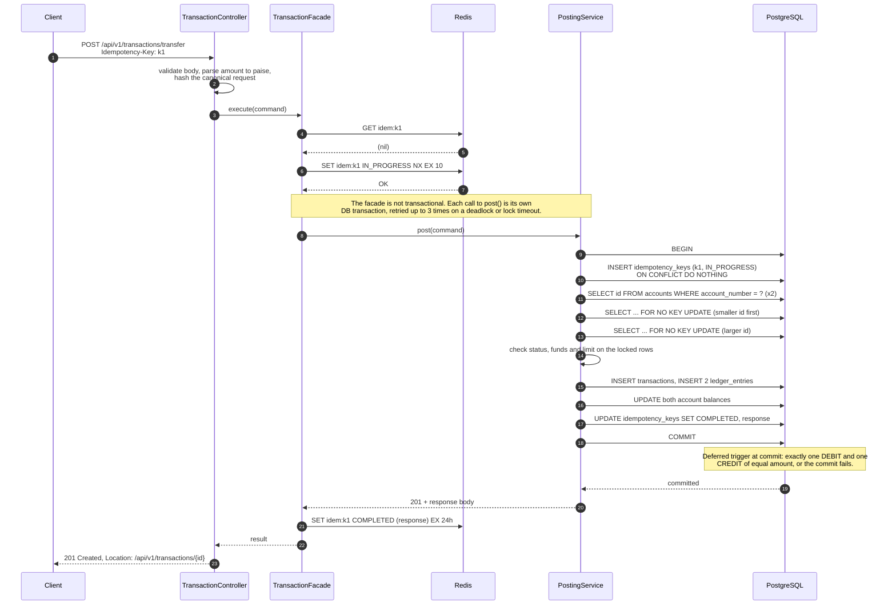
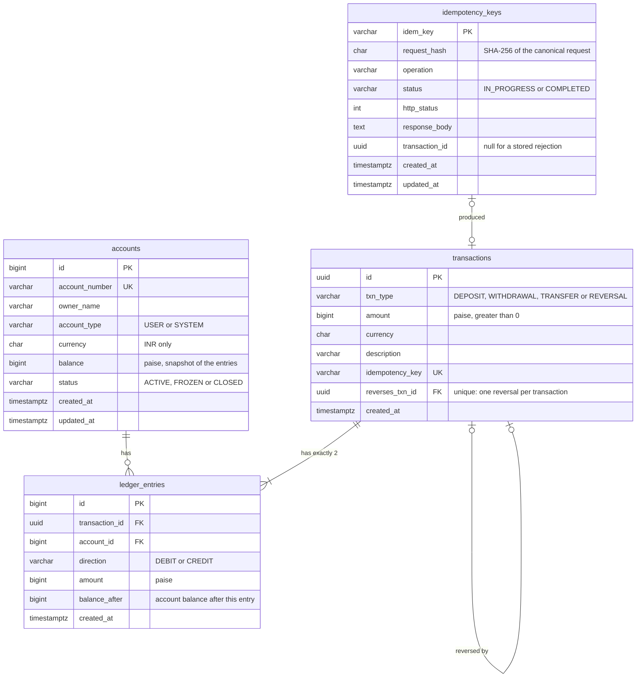

# Design notes

How a posting works, what the database looks like, what happens when things fail, and the reasoning behind the main choices.

## How a transfer is posted

Every money movement goes through the same path: deposit, withdrawal, transfer and reversal. The diagram shows a transfer that is new (the key has not been seen before) and succeeds.

What the other paths do:
- **Repeat of a completed key:** step 4 finds COMPLETED in Redis and returns the stored response with `Idempotent-Replayed: true`, without touching the database. If Redis has no entry, the insert in step 10 conflicts, and Postgres returns the stored row.
- **Same key while the first request is still running:** step 4 or 6 finds another request's IN_PROGRESS marker, and the client gets 409 `REQUEST_IN_PROGRESS` with `Retry-After: 1`.
- **Business rejection** (insufficient funds, frozen account, over the limit): the request stops at step 14. The 422 is stored on the key and committed, so a retry with the same key gets the same 422.
- **Redis unavailable:** steps 4, 6 and 21 are skipped, and the unique key in Postgres alone keeps the request exactly-once.

## Data model

Rules enforced by the database, not just the code:
- `transactions` and `ledger_entries` are append-only. Triggers reject UPDATE, DELETE and TRUNCATE.
- A deferred constraint trigger checks at commit that every transaction has exactly one DEBIT and one CREDIT of the same amount as the transaction. A one-legged or unbalanced transaction cannot commit.
- A USER account's balance cannot go below zero (`CHECK`). The SYSTEM account (`SYS-CASH-0001`) is the other side of every deposit and withdrawal, so its balance is minus the sum of all user money, and all balances together always sum to zero.
- `UNIQUE (transaction_id, direction)`, `UNIQUE (idempotency_key)` and `UNIQUE (reverses_txn_id)` are the last line of defence against double posting and double reversal.
- `idempotency_keys.transaction_id` has no foreign key: a stored rejection has no transaction. Reconciliation checks the link instead (`COMPLETED_KEYS_HAVE_TRANSACTIONS`, `TRANSACTIONS_HAVE_KEYS`).

## Failure scenarios

| Scenario | What happens | Result | Test |
|---|---|---|---|
| Client sends the same key twice, one after the other | The second request finds COMPLETED in Redis, or in Postgres if Redis has no entry | Same response, 1 transaction | `RedisIdempotencyTest.replayIsServedFromRedisWithZeroDatabaseStatements` |
| Same key, 50 concurrent requests, Redis up | One wins `SET NX`. The others get 409 `REQUEST_IN_PROGRESS` while it runs, or a replay after it finishes | Exactly 1 transaction | `ConcurrencyTest` (test 4) |
| Same key, 50 concurrent requests, Redis down | All go to Postgres. The others block on the key's unique index until the first commits, then replay | Exactly 1 transaction | `ConcurrencyTest` (test 5) |
| App crashes after the DB commit, before the Redis write | Redis keeps the IN_PROGRESS marker until its 10s TTL expires, so retries get 409 with `Retry-After: 1`. After that, Postgres replays the stored result | Correct, with a 409 window of up to 10s | `RedisIdempotencyTest.crashBetweenCommitAndRedisWriteGives409UntilTheMarkerExpiresThenADatabaseReplay` (measured 10.4s) |
| App crashes in the middle of the DB transaction | Postgres rolls back, so the key row is gone. The Redis marker expires within 10s | A retry succeeds normally | Covered by Postgres atomicity; the rollback path is tested in `TransactionFacadeTest.failureClearsOurOwnMarkerAndStoresNothing` |
| Redis down entirely | Every Redis call is a miss, and after an error Redis is skipped for 1s, so requests don't each wait out a timeout | Correct; health shows `redis: DEGRADED`, overall `UP` | `RedisOutageTest` |
| Redis restarted or the key evicted | The request reaches Postgres, which replays and refills Redis | Correct | `RedisIdempotencyTest` (control replay with the Redis key deleted) |
| `SET NX` applied by Redis but its reply lost (timeout) | The key is read back. If the marker carries this request's owner token, the request owns it and carries on. If the read-back fails, Postgres decides | Exactly 1 transaction, never a 409 for the request's own marker | `LostSetNxReplyTest` (found by the load test, fixed in `d17485e`) |
| Same key, different body or endpoint | 422 `IDEMPOTENCY_KEY_REUSED`, answered from Redis or Postgres | Nothing written; the key keeps its first meaning | `RedisIdempotencyTest`, `TransactionApiTest` |
| Insufficient funds, retried with the same key | The stored 422 is replayed byte for byte | The client must use a new key after a top-up | `RedisIdempotencyTest.businessRejectionIsCachedAndReplayedIdentically` |
| Lock timeout or deadlock, 3 times | 503 `SYSTEM_BUSY` with `Retry-After: 1`. Nothing is stored and the Redis marker is cleared | The same key can be retried | `TransactionApiTest` (lock held from a separate JDBC connection) |
| Connection pool exhausted (hot account overload) | A request that waits more than 3s for a connection gets 503 `SYSTEM_BUSY` with `Retry-After: 1`. Nothing is written | Load is shed; a retry is safe, and no money moves | Load tests: unique keys sent minus transactions created equals the 503 count exactly |
| Two different reversals of the same transaction | The row lock on the original serializes them. The second sees the first and gets a stored 409 `ALREADY_REVERSED` | Exactly 1 reversal | `ConcurrencyTest` (test 7) |
| Postgres down | Spring can't open a connection, so the request gets 503 `SYSTEM_BUSY` with no stack trace or SQL in the response | Nothing posted | `GlobalExceptionHandlerTest.databaseUnreachableBecomes503WithoutLeakingTheCause` (handler unit test; no test stops Postgres) |

Not covered by tests:
- **Postgres actually going down.** Only the exception handler is tested, with the exception Spring throws when no connection can be opened. No test stops Postgres while the app is running.
- **Graceful shutdown.** `server.shutdown: graceful` is configured, so in-flight requests are allowed to finish on shutdown, but no test checks it.

## Design FAQ

- **Pessimistic over optimistic locking.** Money hot paths have real contention: a popular account, or the system account behind every deposit. Optimistic locking would turn that into many retries and wasted work. A version column is the better choice when conflicts are rare.
- **Why lock ordering prevents deadlock.** Every posting locks its two accounts in ascending id order, so there is never a cycle in the wait-for graph. A->B and B->A queue on the same first row instead of each holding one lock and waiting for the other. The deadlock-bait test shows 0 retries; locking in the wrong order on purpose produces real `40P01` deadlocks.
- **Why Redis alone isn't enough for idempotency.** It is not durable, it can't be written atomically with the Postgres commit, and there is always a crash window between the two. Postgres's unique key is the guard; Redis only answers repeats quickly and turns concurrent duplicates into fast 409s.
- **Why paise as BIGINT.** Integer math is exact, simple and fast. Amounts arrive as strings with at most two decimals and are parsed straight to paise, so no floating-point value ever exists. Formatting is a presentation concern.
- **Why both a balance snapshot and entries.** The entries are the truth; the balance is a cache for O(1) reads. Both are written in the same transaction, and reconciliation proves they agree.
- **Why reversals and not deletes.** The history has to stay intact for audit. A reversal is a new transaction that moves the money back, linked to the original by `reverses_txn_id`.
- **Hot accounts have a ceiling.** All transfers on one pair of accounts run one at a time, so the ceiling is 1 / (lock hold time). About 107/s was measured on a laptop, or about 9.4 ms per transfer, and most of that is database round trips.
- **How it would scale:**
  - partition `ledger_entries` by month;
  - shard accounts by id, with cross-shard transfers needing a saga or two-phase commit;
  - split the system account into N sub-accounts chosen at random, summed for reporting.
